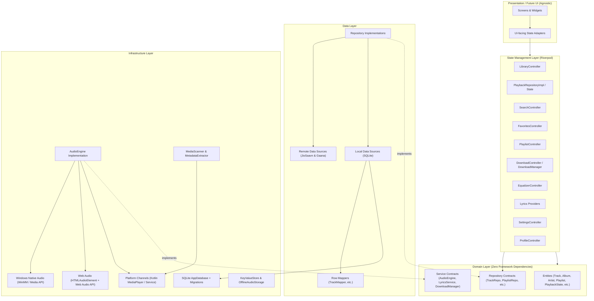

# 03. DEPENDENCY MAP: DATA FLOW AND INTERACTION GRAPH

**Project**: Echo Bloom (UI-Independent Foundation Reconstruction)  
**Reference Workspace**: `d:\FLutter\project` (READ-ONLY)  
**Target Workspace**: `d:\FLutter\redesign UI` (WRITABLE)  
**Date**: November 2026  

---

## 1. Architectural Dependency Hierarchy

The application foundation strictly adheres to uni-directional dependency flow. Higher-level presentation and feature controllers depend on domain abstractions; domain abstractions never depend on concrete data or infrastructure implementations.



---

## 2. Execution Traces & Call Paths

### 2.1 Playback Command Execution
```
Future UI / Client
       │ (calls)
       ▼
PlaybackRepository.play() / skipToNext()
       │
       ├──► Updates PlaybackQueue (moves current track index)
       ├──► Records track to HistoryRepository (SQLite `playback_history`)
       ▼
AudioEngine.load(track) -> AudioEngine.play()
       │
       ├─► [Android]: MethodChannel('audio_player').invokeMethod('play')
       │         └─► MediaPlaybackService (foreground service, media notification, MediaPlayer.start())
       │
       ├─► [Web]: WebAudioPlayer.play()
       │         └─► HTMLAudioElement.play() connected to Web Audio filter graph
       │
       └─► [Windows]: WindowsAudioEngine.play()
                 └─► Native WinMM / Media API execution
```

### 2.2 Remote Search & Streaming Trace
```
User Search Query ("tum hi ho")
       │
       ▼
SearchController.search("tum hi ho")
       │ (debounced 300ms)
       ▼
RemoteMusicDataSource.searchRemoteCatalog("tum hi ho")
       │
       ├──► Step 1: Check memory LRU cache
       ├──► Step 2: Query JioSaavnClient (`/result/?query=tum+hi+ho`)
       │         └─► Success: parse JSON into List<Track>
       │
       └──► Step 3: Fallback (if JioSaavn empty/fails): GaanaClient (`/api/search`)
                 └─► Parse or handle outage gracefully
```

### 2.3 Single Track & Playlist Download Trace
```
Download Request (Track or Playlist)
       │
       ▼
DownloadController / DownloadManager
       │
       ├──► Resolve Playable Stream URI via TrackRepository.resolveStreamUri()
       ├──► HTTP Client streaming GET request with audio User-Agent
       ├──► Stream bytes & track progress
       ├──► Save audio bytes:
       │         ├─► [Native]: File('${appDocumentsDir}/downloads/${safeId}.m4a')
       │         └─► [Web]: SQLite BLOB in `offline_audio_blobs` table
       ├──► Upsert track metadata to SQLite with `sourceType = TrackSourceType.downloaded`
       └──► Update `downloaded_playlists` and `downloaded_playlist_items` progress
```

### 2.4 Equalizer Gain Adjustment Trace
```
Equalizer Slider Changed (e.g. Band 0: 60Hz -> +4.5 dB)
       │
       ▼
EqualizerController.setBandGain(0, 4.5)
       │
       ├──► Update in-memory EqualizerConfiguration
       ├──► Persist configuration via EqualizerRepository (SQLite `key_value_store`)
       ▼
AudioEngine.setEqualizerGains(gains)
       │
       ├─► [Android]: MethodChannel('audio_player').invokeMethod('setEqualizerGains')
       │         └─► android.media.audiofx.Equalizer.setBandLevel(0, millibels)
       │
       ├─► [Web]: WebAudioPlayer.setGains(gains)
       │         └─► BiquadFilterNode[0].gain.value = 4.5
       │
       └─► [Windows]: WindowsAudioEngine (DSP or capability reporting)
```

---

## 3. Package and Dependency Discipline Audit

| Package | Version | Layer | Justification & Compatibility |
|---|---|---|---|
| `flutter_riverpod` | `^2.6.1` | State / DI | Mandatory. Declarative, compile-time safe dependency injection and state management. |
| `sqflite` | `^2.4.1` | Data / Local | Mandatory on Android/iOS. Native SQLite binding. |
| `sqflite_common_ffi` | `^2.3.4+4` | Data / Local | Mandatory for Windows Desktop, macOS, Linux, and unit tests via Dart FFI. |
| `sqflite_common_ffi_web` | `^0.4.3+4` | Data / Local | Mandatory for Web platform persistence via IndexedDB / WASM SQLite. |
| `path` | `^1.9.1` | Core / Storage | Lightweight cross-platform path manipulation. |
| `path_provider` | `^2.1.5` | Infrastructure | Resolves platform-specific document/cache directories on Android, iOS, Windows, macOS, Linux. |
| `equatable` | `^2.0.7` | Domain / State | Value equality for entities, states, and failure models without code generation. |
| `uuid` | `^4.5.1` | Domain / Data | Generates RFC4122 UUIDs for tracks, playlists, and history logs. |
| `permission_handler` | `11.3.1` | Infrastructure | Runtime permission management for Android storage and audio permissions. |
| `http` | `^1.6.0` | Data / Remote | Standard HTTP client for JioSaavn, Gaana, and audio downloads. |
| `web` | `^1.1.1` | Infrastructure | Modern W3C browser APIs for Flutter Web audio and DOM interactions. |
| `mocktail` | `^1.0.4` | Test | Dev dependency for type-safe null-safe unit test mocking without code-gen. |
| `flutter_lints` | `^5.0.0` | Quality | Strict static analysis rules. |
