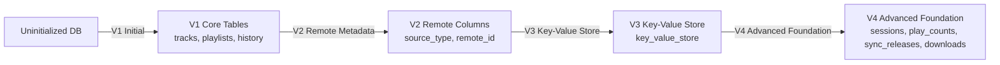

# Database Schema & Versioned Migrations

## 1. Migration History & Schema Evolution

The local database uses SQLite via `sqflite` / `sqflite_common_ffi`. Migrations are orchestrated through [`DatabaseMigrator`](file:///d:/FLutter/redesign%20UI/lib/data/local/database/database_migrator.dart), transitioning deterministically from V0 to V4.



---

## 2. Table Schemas (Version 4 Target)

### 2.1 `tracks` Table
Stores both locally scanned audio tracks and cached remote streaming metadata:
```sql
CREATE TABLE IF NOT EXISTS tracks (
  id TEXT PRIMARY KEY,
  title TEXT NOT NULL,
  artist TEXT NOT NULL,
  album TEXT,
  duration_ms INTEGER NOT NULL,
  media_uri TEXT NOT NULL,
  artwork_uri TEXT,
  source_type TEXT NOT NULL DEFAULT 'localFile',
  remote_id TEXT,
  provider_name TEXT,
  is_favorite INTEGER NOT NULL DEFAULT 0,
  date_added INTEGER NOT NULL,
  folder_path TEXT
);
CREATE INDEX IF NOT EXISTS idx_tracks_artist ON tracks(artist);
CREATE INDEX IF NOT EXISTS idx_tracks_album ON tracks(album);
CREATE INDEX IF NOT EXISTS idx_tracks_folder ON tracks(folder_path);
```

### 2.2 `playlists` & `playlist_items` Tables
```sql
CREATE TABLE IF NOT EXISTS playlists (
  id TEXT PRIMARY KEY,
  name TEXT NOT NULL,
  description TEXT,
  artwork_uri TEXT,
  created_at INTEGER NOT NULL,
  updated_at INTEGER NOT NULL
);

CREATE TABLE IF NOT EXISTS playlist_items (
  playlist_id TEXT NOT NULL,
  track_id TEXT NOT NULL,
  position INTEGER NOT NULL,
  added_at INTEGER NOT NULL,
  PRIMARY KEY (playlist_id, track_id),
  FOREIGN KEY (playlist_id) REFERENCES playlists (id) ON DELETE CASCADE,
  FOREIGN KEY (track_id) REFERENCES tracks (id) ON DELETE CASCADE
);
```

### 2.3 `playback_history` Table
Stores recent tracks played:
```sql
CREATE TABLE IF NOT EXISTS playback_history (
  id INTEGER PRIMARY KEY AUTOINCREMENT,
  track_id TEXT NOT NULL,
  played_at INTEGER NOT NULL,
  playback_duration_ms INTEGER NOT NULL,
  FOREIGN KEY (track_id) REFERENCES tracks (id) ON DELETE CASCADE
);
CREATE INDEX IF NOT EXISTS idx_history_played_at ON playback_history(played_at DESC);
```

### 2.4 `listening_sessions` Table (V4)
Stores YouTube-style qualified sessions ($\ge 5$ seconds active playback):
```sql
CREATE TABLE IF NOT EXISTS listening_sessions (
  id TEXT PRIMARY KEY,
  track_id TEXT NOT NULL,
  session_start INTEGER NOT NULL,
  session_end INTEGER NOT NULL,
  active_playback_seconds INTEGER NOT NULL,
  completed INTEGER NOT NULL DEFAULT 0,
  FOREIGN KEY (track_id) REFERENCES tracks (id) ON DELETE CASCADE
);
CREATE INDEX IF NOT EXISTS idx_sessions_track ON listening_sessions(track_id);
```

### 2.5 `play_counts` Table (V4)
Tracks aggregate play metrics:
```sql
CREATE TABLE IF NOT EXISTS play_counts (
  track_id TEXT PRIMARY KEY,
  play_count INTEGER NOT NULL DEFAULT 0,
  last_played_at INTEGER NOT NULL,
  FOREIGN KEY (track_id) REFERENCES tracks (id) ON DELETE CASCADE
);
```

### 2.6 `sync_releases` & `sync_release_tracks` Tables (V4)
Persists synchronized new albums, singles, and tracks:
```sql
CREATE TABLE IF NOT EXISTS sync_releases (
  id TEXT PRIMARY KEY,
  title TEXT NOT NULL,
  artist TEXT NOT NULL,
  release_date TEXT,
  release_type TEXT,
  artwork_uri TEXT,
  track_count INTEGER NOT NULL DEFAULT 0,
  synced_at INTEGER NOT NULL
);

CREATE TABLE IF NOT EXISTS sync_release_tracks (
  release_id TEXT NOT NULL,
  track_id TEXT NOT NULL,
  position INTEGER NOT NULL,
  PRIMARY KEY (release_id, track_id),
  FOREIGN KEY (release_id) REFERENCES sync_releases(id) ON DELETE CASCADE,
  FOREIGN KEY (track_id) REFERENCES tracks(id) ON DELETE CASCADE
);
```

### 2.7 `download_tasks` Table (V4)
Maintains offline download state and resumability:
```sql
CREATE TABLE IF NOT EXISTS download_tasks (
  track_id TEXT PRIMARY KEY,
  destination_path TEXT NOT NULL,
  status TEXT NOT NULL,
  bytes_downloaded INTEGER NOT NULL DEFAULT 0,
  total_bytes INTEGER NOT NULL DEFAULT 0,
  updated_at INTEGER NOT NULL,
  FOREIGN KEY (track_id) REFERENCES tracks(id) ON DELETE CASCADE
);
```

---

## 3. Database Backup & Disaster Recovery

[`DatabaseBackupService`](file:///d:/FLutter/redesign%20UI/lib/data/local/database/database_backup_service.dart) provides:
1. **Integrity Validation**: Runs `PRAGMA integrity_check;` to verify B-tree and relational health.
2. **Atomic Export**: Extracts user libraries, custom playlists, sessions, and settings to a structured JSON document.
3. **Atomic Restore**: Restores user data within an SQLite transaction (`ConflictAlgorithm.replace`), rolling back completely if malformed.
4. **Corrupt DB Recovery**: Detects corrupted SQLite files and cleanly backs up corrupt data before re-initializing from schema V1-V4.
