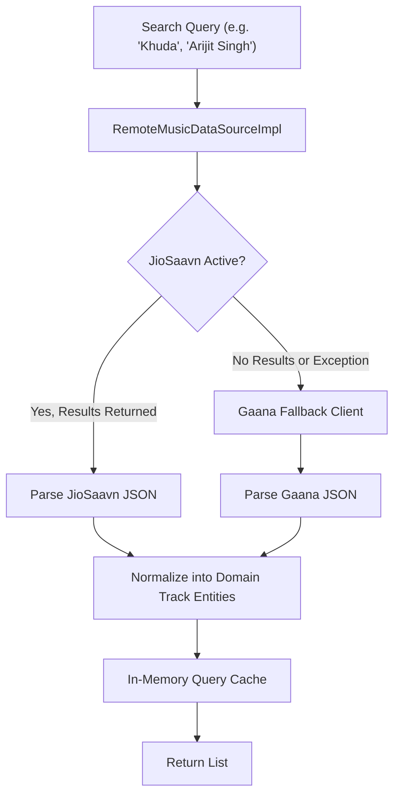

# API Providers & Configuration Guide

## 1. Overview of Streaming APIs

Echo Bloom integrates with two major streaming providers to power remote music search, track resolution, and releases sync:
1. **JioSaavn API (Primary Provider)**
2. **Gaana API (Fallback Provider)**



---

## 2. Provider Specifications

### 2.1 JioSaavn Client (`JioSaavnClient`)
- **Default Base Endpoint:** `https://saavnapi-nine.vercel.app`
- **Search Endpoint:** `/result/?query={query}`
  - Returns song metadata, 320kbps and 96kbps AAC audio streams (`media_url`, `media_preview_url`), 500x500 album art (`image`), artists, albums, and copyright info.
- **Album Endpoint:** `/album/?query={album_perma_url}`
  - Returns complete tracklist and release year.
- **HTML Entity Sanitization:** Automatically decodes escaped HTML entities in song titles and artist names (e.g., `&amp;` $\to$ `&`, `&quot;` $\to$ `"`).
- **Verified Query Results:**
  - `Khuda`: Returns songs such as "Khuda Bhi" (*Ek Paheli Leela*), "Khuda Jaane" (*Bachna Ae Haseeno*).
  - `Arijit Singh`: Returns discography including "Kesariya", "Tum Hi Ho", "Channa Mereya".

### 2.2 Gaana Client (`GaanaClient`)
- **Default Base Endpoint:** `https://gaana-api-two.vercel.app`
- **Search Endpoint:** `/search?q={query}`
- **Fallback Trigger:** Activates seamlessly if JioSaavn returns HTTP errors, empty result sets, or exceeds timeout limits.
- **Stream Resolution:** Resolves dynamic streaming tokens into direct playback URLs via `/track?id={track_id}`.

---

## 3. Configuration & Custom Endpoints

Providers are configurable via constructor parameters and dependency injection:

```dart
final customJioClient = JioSaavnClient(
  baseUrl: 'https://my-custom-jiosaavn-proxy.org',
  httpClient: ResilientHttpClient(),
);

final customGaanaClient = GaanaClient(
  baseUrl: 'https://my-custom-gaana-proxy.org',
  httpClient: ResilientHttpClient(),
);
```

### 3.1 Rate Limit Management
- Responses bearing HTTP 429 automatically respect the `Retry-After` header.
- The `ResilientHttpClient` will retry up to 3 times using jittered exponential backoff before failing safely with a typed `NetworkFailure`.
