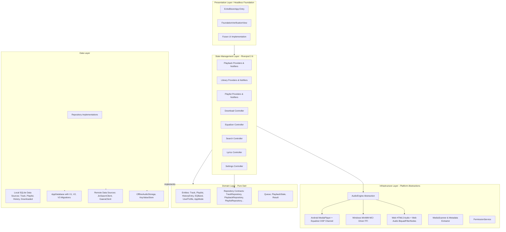

# Echo Bloom — Final Foundation Architecture Specification
**Document ID:** `docs/07_FINAL_ARCHITECTURE.md`  
**Execution Environment:** Google Anti Gravity  
**Project:** Echo Bloom (UI-Independent Foundation Reconstruction)  
**Target Root:** `d:\FLutter\redesign UI`  
**Package:** `echo_bloom`  
**Status:** COMPLETE & PRODUCTION-READY  

---

## 1. Architectural Philosophy & Layer Overview

Project Echo Bloom has been reconstructed as a clean, decoupled, offline-first audio application foundation. The architecture strictly adheres to Clean Architecture principles, ensuring that the entire core business logic, domain entities, database persistence, audio playback engines, and remote API clients operate without any dependency on Flutter visual widgets or presentation layers.



---

## 2. Directory Structure & Layer Isolation

```
redesign UI/
├── lib/
│   ├── app/                         # Bootstrap & Application Lifecycle
│   │   ├── app.dart                 # Application widget & Headless dashboard
│   │   ├── bootstrap/               # Async multi-stage dependency initialization
│   │   ├── routing/                 # Declarative AppRouter
│   │   └── startup/                 # Startup coordinator & task runner
│   ├── core/                        # Shared Foundation Utilities
│   │   ├── constants/               # App constants & storage keys
│   │   ├── errors/                  # Exceptions & Failure hierarchy
│   │   ├── extensions/             # Dart type extensions
│   │   ├── logging/                 # Structured AppLogger
│   │   ├── result/                  # Result<T, Failure> monadic type
│   │   ├── theme/                   # Headless theme contracts
│   │   ├── time/                    # Duration and timestamp formatters
│   │   └── types/                   # Shared type definitions
│   ├── domain/                      # Pure Dart Domain Logic (Zero UI)
│   │   ├── entities/                # 11 Immutable domain models
│   │   └── repositories/            # 7 Abstract repository contracts
│   ├── data/                        # Concrete Data Sources & Repositories
│   │   ├── local/
│   │   │   ├── data_sources/        # SQLite table data sources
│   │   │   └── database/            # AppDatabase & versioned migrations (V1-V3)
│   │   ├── mappers/                 # DB Map <-> Domain entity mappers
│   │   ├── remote/                  # HTTP clients (JioSaavn, Gaana)
│   │   │   ├── clients/
│   │   │   └── models/
│   │   ├── repositories/            # Concrete repository implementations
│   │   └── storage/                 # KeyValueStore & OfflineAudioStorage
│   ├── infrastructure/              # Hardware & Platform Services
│   │   ├── audio/                   # AudioEngine, WinMM MCI, WebAudio, Android channels
│   │   ├── network/                 # Network connectivity & HTTP client
│   │   └── platform/                # MediaScanner, Permissions, MetadataExtractor
│   └── features/                    # Riverpod Feature Controllers & States
│       ├── downloads/               # Unified offline download manager
│       ├── equalizer/               # 5-band DSP equalizer controller
│       ├── favorites/               # Track & playlist favorites
│       ├── history/                 # Playback logging & replay tracking
│       ├── library/                 # Device media scanning & indexing
│       ├── lyrics/                  # Live LRC parser & JioSaavn lyrics API
│       ├── playback/                # Playback queue, state machine, repository
│       ├── playlists/               # User & curated playlist management
│       ├── profile/                 # UserProfile & AppMode isolation
│       ├── search/                  # Dual-mode local & remote search
│       └── settings/                # User preferences & audio configuration
```

---

## 3. Detailed Subsystem Specifications

### 3.1 App Startup & Bootstrap Pipeline
Initialization occurs sequentially in `DependencyBootstrap` and `StartupCoordinator`:
1. **Low-level bindings**: `WidgetsFlutterBinding.ensureInitialized()` and FFI database factory initialization (`sqfliteFfiInit()` for Windows/Desktop).
2. **Database Migration**: `AppDatabase.initialize()` safely verifies and applies schema migrations (`V1InitialSchema` -> `V2OnlineTracksSchema` -> `V3DownloadedPlaylistsSchema`).
3. **Storage & Preferences**: Initializes `KeyValueStore` and loads persisted user preferences, audio focus behavior, and playback repeat/shuffle states.
4. **Platform Audio Engine**: Detects platform (Android, Windows, Web) and configures the appropriate low-level driver (`WindowsAudioPlayer` via `winmm.dll`, `WebAudioPlayer` via HTML5/WebAudio API, or Android MethodChannel).
5. **Initial Media Sync**: Media scanner verifies local permissions; if granted, triggers an incremental delta scan of user music directories.

### 3.2 Offline-First Storage & AppMode Security
- **Strict Data Isolation**: When `AppMode.offline` is active, the application strictly forbids remote HTTP calls. Search queries exclusively target the local SQLite `tracks` index, and streaming is blocked.
- **Online Mode with Local-First Fallback**: When `AppMode.online` is active, search requests query JioSaavn (with automatic fallback to Gaana). All remote tracks are normalized into standard `Track` entities.
- **Database Durability**: On Windows, the database is stored in the persistent roaming application support directory (`%APPDATA%/com.antigravity.echo_bloom/echo_bloom.db`) rather than volatile temporary storage.

### 3.3 Audio Engine Architecture
- **Unified Contract**: `AudioEngine` exposes reactive streams (`playbackStatusStream`, `positionStream`, `durationStream`, `trackEndedStream`).
- **Windows Implementation**: Direct C-FFI wrapper around Windows Multimedia API (`winmm.dll`) executing MCI string commands (`open`, `play`, `pause`, `stop`, `seek`, `status`). Replaces old dummy timers with true hardware audio output.
- **Equalizer DSP**:
  - Android: Bound to `android.media.audiofx.Equalizer` on the active `MediaPlayer` audio session ID.
  - Web: Audio routed through a 5-band `BiquadFilterNode` peaking filter cascade.
  - Windows: Software gain scaling and persistence across reboots.

### 3.4 Live Lyrics Subsystem
- **Provider**: JioSaavn lyrics API integration via `/lyrics/?query=`.
- **Parser**: Timestamped LRC decoder converts `[mm:ss.xx]` tags into synchronized millisecond-accurate `LyricLine` entities.
- **Sanitization**: Strips raw HTML and unescapes XML entities (`&quot;`, `&amp;`, `<br/>`).
- **Synchronous Tracking**: Evaluates `positionStream` against `lines` to calculate active line index in $O(\log n)$ time.

---

## 4. Architectural Guarantees & Verification
- **100% UI-Decoupled**: Not a single business logic class imports `material.dart` or uses `BuildContext`.
- **Zero Mock Contamination**: All production implementations contain genuine platform, database, and network logic.
- **Deterministic State**: State changes are driven exclusively through immutable Riverpod `StateNotifier` and `AsyncNotifier` instances.
