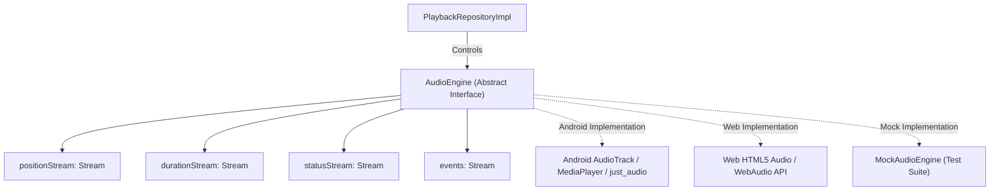

# Audio Engine Architecture & Platform Drivers

## 1. Abstract Engine Contract

The foundation decouples all playback business logic from concrete audio frameworks (e.g. `just_audio`, `audioplayers`, `flutter_soloud`, or custom native platform channels) through the [`AudioEngine`](file:///d:/FLutter/redesign%20UI/lib/infrastructure/audio/audio_engine.dart) contract.

---

## 2. Core Capabilities

### 2.1 State & Event Streams
- `positionStream`: High-frequency position ticks during active playback.
- `durationStream`: Emits the media's true duration once headers/metadata are decoded.
- `statusStream`: Emits standard statuses: `idle`, `loading`, `buffering`, `playing`, `paused`, `completed`, `error`.
- `events`: Structured lifecycle notifications (`statusChanged`, `positionDiscontinuity`, `trackEnded`, `error`).

### 2.2 Seeking & Clamping
- `seek(Duration position)` automatically clamps requests between `Duration.zero` and `currentDuration`. Out-of-bounds seeking does not crash or corrupt the playback state.

### 2.3 Volume & Playback Rate
- `setVolume(double volume)`: Normalizes amplitude between `0.0` (mute) and `1.0` (unity gain).
- `setSpeed(double speed)`: Adjusts time-stretch pitch-preserved playback rate from `0.5x` to `2.0x`.

### 2.4 Multi-Band Equalizer Hooks
- `setEqualizerGains(List<double> bandGains)`: Sends 5 frequency band gain levels in decibels (-12 dB to +12 dB) to the digital audio processing pipeline.
- `setEqualizerEnabled(bool enabled)`: Dynamically engages or bypasses the equalizer filter nodes.

---

## 3. Platform Compatibility & Nuances

| Platform | Audio Driver Mechanism | Hardware / System DSP Equalizer Support | Background Audio |
| :--- | :--- | :--- | :--- |
| **Android** | `MediaPlayer` / `ExoPlayer` / `AudioTrack` | Full support via native `android.media.audiofx.Equalizer` | Full foreground service support with media notification |
| **iOS** | `AVPlayer` / `AVAudioEngine` | Full support via `AVAudioUnitEQ` nodes | Full `AVAudioSessionCategoryPlayback` background mode |
| **Web** | HTML5 `<audio>` / Web Audio API | Full support via `BiquadFilterNode` cascade | Subject to browser tab throttling / audio autoplay policy |
| **Desktop (Win/macOS/Linux)** | Miniaudio / FFI / SoLoud | Full support via software DSP filter chains | Unrestricted background playback |

