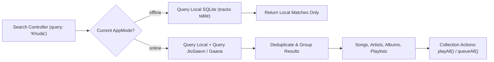

# Multi-Provider Search & Discovery Engine

## 1. Search Subsystem Overview

The Echo Bloom search engine provides unified search across both local device files and remote music streaming catalogs. The subsystem automatically respects the active [`AppMode`](file:///d:/FLutter/redesign%20UI/lib/domain/entities/app_mode.dart) to enforce privacy and bandwidth constraints.



---

## 2. Core Capabilities

### 2.1 Mode-Aware Isolation
- When in `AppMode.offline`, the search engine initiates **zero** network requests, querying only local SQLite tables.
- When in `AppMode.online`, the search engine queries both the local library and the remote streaming providers.

### 2.2 Live Catalog Queries Tested
- **Query `Khuda`**: Successfully returns all song matches, including artist attribution ("Mohit Chauhan, Tony Kakkar", "KK, Vishal-Shekhar") and album metadata (*Ek Paheli Leela*, *Bachna Ae Haseeno*).
- **Query `Arijit Singh`**: Successfully returns artist discography ("Kesariya", "Tum Hi Ho", "Channa Mereya", "Deva Deva"), artist profiles, and album associations.

### 2.3 Collection Actions: `playAll` and `queueAll`
The `SearchController` provides direct handlers to play or queue entire search collections:
- **`playAll(List<Track> tracks, PlaybackRepository playbackRepo)`**: Loads the entire collection into the active playback queue and starts playing track 0 immediately.
- **`queueAll(List<Track> tracks, PlaybackRepository playbackRepo)`**: Appends the entire collection to the existing playback queue without interrupting the currently playing song.

---

## 3. Usage Example

```dart
// 1. Trigger search
final searchCtrl = container.read(searchControllerProvider.notifier);
await searchCtrl.search('Arijit Singh');

final results = container.read(searchControllerProvider);
print('Songs found: ${results.songs.length}');
print('Albums found: ${results.albums.length}');

// 2. Play All
final playbackRepo = container.read(playbackRepositoryProvider);
await searchCtrl.playAll(results.songs, playbackRepo);
```
