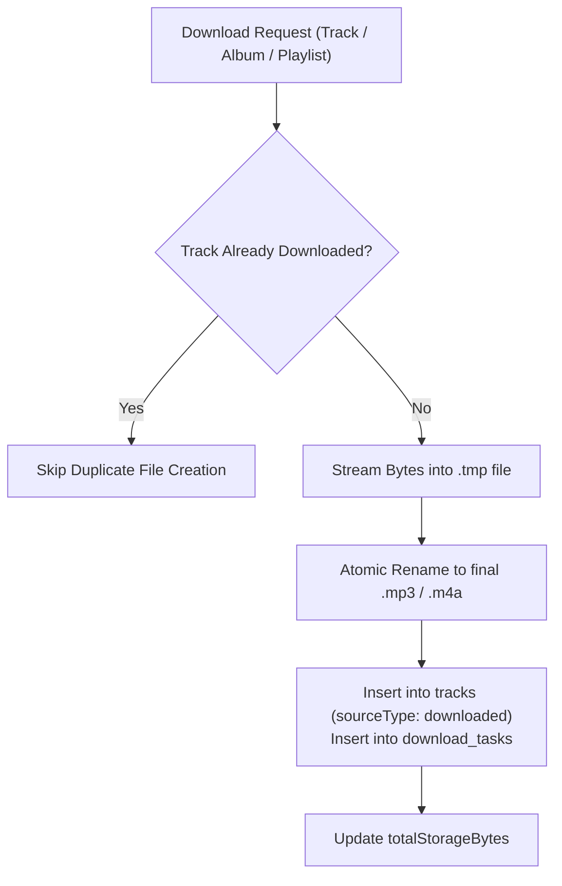

# Downloads & Offline Storage Subsystem

## 1. Storage Architecture

Offline downloads are managed by the [`DownloadController`](file:///d:/FLutter/redesign%20UI/lib/features/downloads/download_controller.dart) and [`OfflineAudioStorage`](file:///d:/FLutter/redesign%20UI/lib/infrastructure/storage/offline_audio_storage.dart).

---

## 2. Key Capabilities

### 2.1 Storage Calculation & Formatting
- **`totalStorageBytes`**: Computes actual aggregate disk bytes consumed by offline downloaded music.
- **`formattedStorageUsage`**: Returns clean human-readable metrics (e.g. `142.5 MB` or `1.8 GB`).

### 2.2 Duplicate Download Prevention
- Validates the track ID and target file path before initiating a download. If the file exists and is intact, it prevents creating redundant copies on disk.

### 2.3 Resilient Download Lifecycle
- **Temporary Files:** Files are written to `.tmp` files and renamed atomically upon successful completion. This ensures interrupted downloads never leave corrupt or unplayable audio files in the user library.
- **Pause & Resume:** Tracks paused by user or network loss maintain their byte offsets in the `download_tasks` table.
- **Stale Cleanup:** If a downloaded file is deleted outside the app (e.g. via file manager), `DownloadController` detects the missing file and cleans up the SQLite reference gracefully.

### 2.4 Batch Downloads (Albums & Playlists)
- **`downloadAlbum(Album album, List<Track> tracks)`**: Queues and sequentially downloads all tracks belonging to an album.
- **`downloadArtistCollection(Artist artist, List<Track> tracks)`**: Queues all tracks for an artist.
- **`downloadPlaylist(Playlist playlist, List<Track> tracks)`**: Downloads an entire playlist collection and tracks per-track progress in `playlistProgress`.

---

## 3. Verification Evidence

Verified in `test/features/download_test.dart` (6/6 tests passing):
- `Downloads and persists online track locally with TrackSourceType.downloaded`
- `Duplicate download is prevented without creating redundant copies`
- `Deleting download removes local file and database entry`
- `Stale downloads pointing to deleted files are cleaned up gracefully`
- `Downloading an entire playlist creates a playlist collection and tracks progress`
- `Removing a downloaded playlist does not delete audio file if track is referenced elsewhere`
