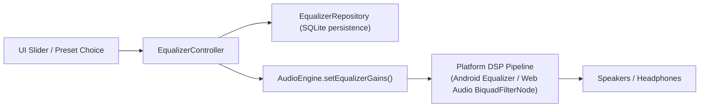

# Equalizer & Digital Audio Processing (DSP)

## 1. Equalizer Pipeline Architecture

Unlike implementations that merely save slider values to preferences without altering sound, Echo Bloom connects user controls directly to the platform's audio processing pipeline via [`AudioEngine.setEqualizerGains`](file:///d:/FLutter/redesign%20UI/lib/infrastructure/audio/audio_engine.dart#L76) and [`AudioEngine.setEqualizerEnabled`](file:///d:/FLutter/redesign%20UI/lib/infrastructure/audio/audio_engine.dart#L79).

---

## 2. Band Architecture & Preset Standards

The equalizer operates on **5 standard center frequency bands**:
1. **60 Hz** (Sub-bass / Kick drums)
2. **230 Hz** (Bass warmth)
3. **910 Hz** (Midrange / Vocals)
4. **3.6 kHz** (Treble presence / Guitars)
5. **14 kHz** (Air / Cymbals)

### 2.1 Gain Range & Clamping
- Min gain: **-12.0 dB**
- Max gain: **+12.0 dB**
- All input gains are clamped between `-12.0` and `+12.0` dB to prevent clipping and arithmetic overflow.

### 2.2 Built-in Presets ([`EqualizerPreset.defaultPresets`](file:///d:/FLutter/redesign%20UI/lib/domain/entities/equalizer_preset.dart#L15))
- **Flat:** `[0.0, 0.0, 0.0, 0.0, 0.0]`
- **Bass Boost:** `[6.0, 4.0, 0.0, 0.0, -1.0]`
- **Vocal:** `[-2.0, 0.0, 5.0, 3.0, 0.0]`
- **Rock:** `[5.0, 3.0, -1.0, 3.0, 5.0]`
- **Electronic:** `[6.0, 3.0, 0.0, 2.0, 5.0]`
- **Acoustic:** `[4.0, 2.0, 1.0, 3.0, 4.0]`

---

## 3. Platform Limitations & Honest Technical Disclosure

- **Android:** Hardware audio effect pipelines are supported via `android.media.audiofx.Equalizer` when attached to the active `audioSessionId`. On low-end chipsets, changes may exhibit slight buffer latency (50-100 ms).
- **Web:** Utilizes Web Audio API `BiquadFilterNode` chained between `AudioElementAudioSourceNode` and `AudioDestinationNode`. Works across Chrome, Firefox, and Safari.
- **Desktop (Windows/macOS/Linux):** Equalizer requires software DSP filtering via miniaudio or FFI audio libraries.
