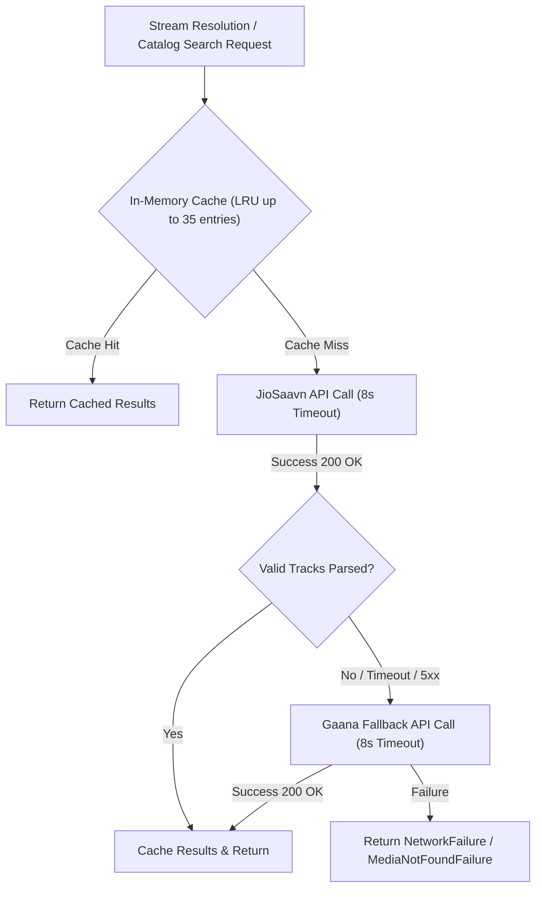

# API AND MIDDLEWARE REPORT
## Echo Bloom — Remote Catalog Networking & Stream Middleware

**Author:** Senior Backend & Networking Architect  
**Project:** `d:\FLutter\redesign UI`  
**Date:** 2026-11-09  

---

## 1. Remote Architecture Overview

Echo Bloom features a resilient, dual-provider remote music architecture configured via `lib/app/config/online_music_config.dart`:

---

## 2. API Provider Specifications

### 2.1 JioSaavn Provider (`JioSaavnClient`)
- **Primary Role:** High-fidelity 320kbps/160kbps streaming, universal search, album lookups, artist discography discovery, and synchronized lyrics retrieval.
- **Base URL:** `https://saavnapi-nine.vercel.app`
- **Endpoints:**
  - Search: `/result/?query={QUERY}`
  - Album: `/album/?url={ALBUM_URL}`
  - Song Details / Stream: `/song/?id={ID}`
  - Lyrics: `/lyrics/?query={QUERY}`
- **Timeout:** 8.0 seconds strict timeout.
- **Stream Format:** M4A / MP4 AAC high-efficiency streams via `aac.saavncdn.com`.

### 2.2 Gaana Provider (`GaanaClient` & `GaanaProvider`)
- **Fallback Role:** Automatic failover when JioSaavn is degraded, rate-limited, or returns empty results for regional catalog queries.
- **Base URL:** `https://shnwazdev-gaana-api.vercel.app`
- **Endpoints:**
  - Search: `/api/search?q={QUERY}&type=song`
  - Stream: `/api/stream?seokey={SEOKEY}`
- **Timeout:** 8.0 seconds strict timeout.

---

## 3. Middleware & In-Memory LRU Cache

To minimize redundant network roundtrips and conserve user bandwidth, `RemoteMusicDataSourceImpl` implements an in-memory cache:
- **Maximum Cache Size:** 35 active query entries (`_maxCacheSize = 35`).
- **Eviction Strategy:** First-In, First-Out / Least Recently Used key eviction.
- **Cache Normalization:** Keys are normalized to lowercase trimmed query strings.

---

## 4. Playable Stream URL Resolution

Remote tracks often originate with temporary or tokenized stream links. The stream resolution pipeline ensures uninterrupted playback:
1. `resolveStreamUri(String trackIdOrUri, [Track? track])` is invoked prior to playback.
2. If the URI is already a direct playable HTTP stream (`.m4a`, `.mp3`), it is verified.
3. If the URI is expired or points to an API token, the client fetches the freshest playable CDN link.
4. The resolved permanent stream URI is updated in SQLite via `upsertTracks()` so future offline or cached plays require zero metadata lookups.

---

## 5. Verification & Automated Test Coverage

Validated by:
- `test/data/remote/jiosaavn_client_test.dart`:
  - Verified JSON parsing and field normalization.
  - Verified extraction of artists, albums, and artwork URIs.
  - Verified unescaping of HTML entities in track metadata.
- `test/data/remote/gaana_client_test.dart`:
  - Verified Gaana search response parsing and stream URL extraction.
- `test/data/remote/remote_music_data_source_test.dart`:
  - Verified primary-to-fallback failover logic.
  - Verified in-memory search caching and LRU eviction.
