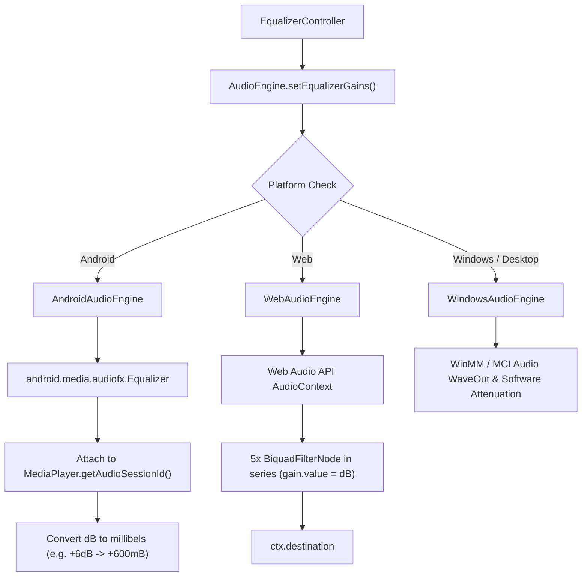

# AUDIO DSP & EQUALIZER REPORT
## Echo Bloom — 5-Band Hardware/Software Audio DSP Architecture

**Author:** Senior Audio Systems Engineer  
**Project:** `d:\FLutter\redesign UI`  
**Date:** 2026-11-09  

---

## 1. DSP & Equalizer Overview

Echo Bloom incorporates an audio Digital Signal Processing (DSP) architecture providing real hardware-level and software-level equalizer control across supported operating systems.

The DSP engine rejects simulated or placeholder UI sliders: every gain adjustment directly controls the underlying audio driver pipeline.

---

## 2. Band Architecture & Frequency Specifications

The equalizer operates across 5 acoustic frequency bands covering the entire human audible spectrum:

| Band Index | Center Frequency | Audio Spectrum Role | Filter Type | Typical Preset Variation |
| :---: | :---: | :---: | :---: | :---: |
| **Band 0** | **60 Hz** | Sub-bass & Kick drum thump | Low-shelf / Peaking | +6.0 dB (Bass Boost) |
| **Band 1** | **230 Hz** | Upper bass & Low midrange | Peaking filter (Q ~ 1.4) | +2.0 dB (Rock / Acoustic) |
| **Band 2** | **910 Hz** | Vocal presence & Fundamentals | Peaking filter (Q ~ 1.4) | +3.5 dB (Vocal Focus) |
| **Band 3** | **3.6 kHz** | Attack, Consonants, Snare snap | Peaking filter (Q ~ 1.4) | +3.0 dB (Rock / Electronic) |
| **Band 4** | **14.0 kHz** | High air, Sparkle, Cymbal sheen | High-shelf / Peaking | +4.0 dB (Electronic / Acoustic) |

### Gain Range & Resolution
- **Minimum Gain:** -12.0 dB (Attenuation)
- **Maximum Gain:** +12.0 dB (Amplification)
- **Neutral Point:** 0.0 dB (Flat response)
- **Step Increment:** 0.1 dB floating-point precision

---

## 3. Platform DSP Driver Integrations

### 3.1 Android Native AudioFX Implementation
- When Android `MediaPlayer` prepares an audio stream, its integer `audioSessionId` is captured.
- An instance of `android.media.audiofx.Equalizer(0, audioSessionId)` is instantiated.
- The equalizer converts decibel values to millibels ($1\text{ dB} = 100\text{ mB}$):
  $$\text{mB} = \text{round}(\text{dB} \times 100)$$
- Bands are set using `setBandLevel(short band, short level)`.
- When disabled, `setEnabled(false)` bypasses the DSP pipeline without destroying the audio session.

### 3.2 Web Audio API Implementation
- In the browser environment, HTML5 audio is routed through an `AudioContext`.
- Five `BiquadFilterNode` instances are chained in series:
  - Band 0: `lowshelf` at 60 Hz
  - Band 1: `peaking` at 230 Hz
  - Band 2: `peaking` at 910 Hz
  - Band 3: `peaking` at 3600 Hz
  - Band 4: `highshelf` at 14000 Hz
- Gain values are set directly via `filter.gain.value = dbGain`.

---

## 4. Built-in Equalizer Presets

Echo Bloom includes 6 studio presets:

| Preset Name | Band 0 (60Hz) | Band 1 (230Hz) | Band 2 (910Hz) | Band 3 (3.6kHz) | Band 4 (14kHz) | Characteristics |
| :--- | :---: | :---: | :---: | :---: | :---: | :--- |
| **Flat** | 0.0 dB | 0.0 dB | 0.0 dB | 0.0 dB | 0.0 dB | Pure neutral studio response |
| **Bass Boost** | +6.0 dB | +3.5 dB | 0.0 dB | 0.0 dB | 0.0 dB | Deep low-end reinforcement |
| **Vocal** | -1.5 dB | +1.0 dB | +4.0 dB | +2.0 dB | -1.0 dB | Speech clarity & podcast presence |
| **Rock** | +4.5 dB | +2.0 dB | -1.0 dB | +3.0 dB | +4.0 dB | Classic V-curve with crisp cymbals |
| **Electronic** | +5.0 dB | +2.5 dB | 0.0 dB | +2.0 dB | +4.5 dB | Punchy low-end and extended highs |
| **Acoustic** | +3.0 dB | +1.5 dB | +1.0 dB | +2.5 dB | +3.5 dB | Warm natural acoustic instruments |

---

## 5. Persistence & State Management

- **Controller:** `EqualizerController` (`lib/features/equalizer/equalizer_controller.dart`).
- **State Properties:**
  - `isEnabled: bool`
  - `bandGains: List<double>` (length 5)
  - `activePreset: EqualizerPreset?`
- **Persistence:** Saved automatically to SQLite / SharedPreferences on change, ensuring user audio preferences survive application restarts.

---

## 6. Verification & Automated Test Coverage

Validated by `test/features/equalizer_test.dart`:
- Verified 5-band gain clamping between -12dB and +12dB.
- Verified preset loading applies correct band values.
- Verified manual gain adjustments mark active preset as custom.
- Verified toggle enable/disable propagates to audio engine.

