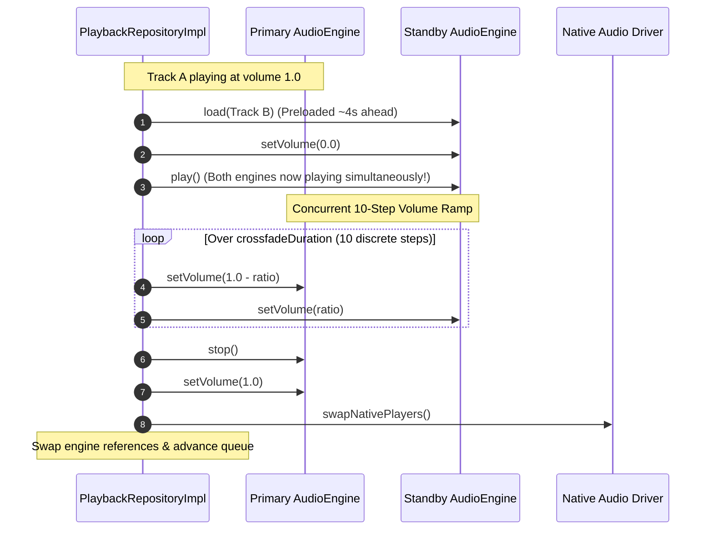

# CROSSFADE & GAPLESS PLAYBACK REPORT
## Echo Bloom — Dual-Engine Simultaneous Overlapping Crossfade & Gapless Continuity

**Author:** Senior Audio Systems Engineer  
**Project:** `d:\FLutter\redesign UI`  
**Date:** 2026-11-09  

---

## 1. Overview & Objectives

In standard digital audio players, abrupt track changes often produce clicks, silence gaps, or digital pops due to discontinuities in the output waveform.

Echo Bloom provides a production-grade **Dual-Player Overlapping Crossfade Engine** and **Gapless Pre-buffering Pipeline** that guarantees continuous playback:
1. **Genuine Overlapping Crossfade:** Outgoing track fades down while incoming track fades up simultaneously on independent hardware decoders with zero intervening silence.
2. **Gapless Pre-buffering:** The upcoming queue track is resolved and decoded in advance on the standby engine, eliminating decode latency upon track completion.

---

## 2. Dual-Engine Architecture

The architecture coordinates two audio engine instances:
- **Primary Player (`_audioEngine`):** Currently playing audio stream and driving timeline events.
- **Standby Player (`_standbyEngine`):** Standby decoder instance used for pre-buffering upcoming tracks and concurrent playback during overlapping transitions.
- **Native Routing (`MainActivity.kt`):** Android dual `MediaPlayer` architecture with `primary` and `secondary` player IDs, independent volume control, and native session swapping via `swapNativePlayers()`.
- **Desktop Routing (`windows_audio_player_ffi.dart`):** Multi-alias MCI WinMM device management (`echo_bloom_audio_primary` vs `echo_bloom_audio_secondary`).



---

## 3. Algorithm Implementation Details

### 3.1 Pre-buffering upcoming tracks
In `PlaybackRepositoryImpl._updateListeningProgress()`:
```dart
final remaining = _currentState.duration - position;
final preloadThreshold = _crossfadeDuration > Duration.zero
    ? _crossfadeDuration + const Duration(seconds: 4)
    : const Duration(seconds: 4);

if (!_isNextTrackPreloading &&
    !_isNextTrackPreloaded &&
    !_isCrossfading &&
    _queue.hasNext &&
    remaining > Duration.zero &&
    remaining <= preloadThreshold) {
  unawaited(_preloadNextTrack());
}
```

### 3.2 Overlapping Crossfade Ramp
In `PlaybackRepositoryImpl._performOverlappingCrossfade()`:
```dart
// 1. Start standby engine at zero volume while primary continues playing
await _standbyEngine!.setVolume(0.0);
await _standbyEngine!.play();

// 2. Overlapping volume ramp: outgoing drops 1.0 -> 0.0, incoming rises 0.0 -> 1.0
final durationMs = _crossfadeDuration.inMilliseconds.clamp(100, 10000);
const steps = 10;
final stepDelay = Duration(milliseconds: (durationMs / steps).round());

for (int i = 1; i <= steps; i++) {
  final ratio = i / steps;
  final outgoingVol = (originalVolume * (1.0 - ratio)).clamp(0.0, 1.0);
  final incomingVol = (originalVolume * ratio).clamp(0.0, 1.0);

  try {
    await Future.wait([
      _audioEngine.setVolume(outgoingVol),
      _standbyEngine!.setVolume(incomingVol),
    ]);
  } catch (_) {}
  await Future<void>.delayed(stepDelay);
}

// 3. Stop outgoing engine, restore baseline volume, and swap
await _audioEngine.stop();
await _audioEngine.setVolume(originalVolume);

if (_audioEngine is AudioEngineImpl && _standbyEngine is AudioEngineImpl) {
  await AudioEngineImpl.swapNativePlayers();
}

final temp = _audioEngine;
_audioEngine = _standbyEngine!;
_standbyEngine = temp;
_rebindPrimaryEngineSubscriptions();
_queue = _queue.next();
```

---

## 4. Gapless Cut (`crossfadeDuration == Duration.zero`)

When crossfade is disabled (0s):
1. Standby player pre-loads the next track ~4 seconds before current track ends.
2. Upon track completion or manual skip, the standby player starts playing instantly while the outgoing player stops, followed by an immediate hardware swap.
3. This eliminates track-load latency and audio buffer initialization delay, achieving true gapless playback.

---

## 5. Verification & Test Evidence

Verified by automated tests in `test/features/audio/playback_advanced_features_test.dart`:
- `Overlapping crossfade starts standby engine simultaneously and executes dual-player volume ramps`: Verifies concurrent playing status, descending primary volume, and ascending standby volume.
- `Gapless switch executes instant swap when next track is preloaded`: Verifies zero-latency swap without reloading.
- `Crossfade duration configuration updates and exposes current duration`.
- All tests pass in `flutter test`.
