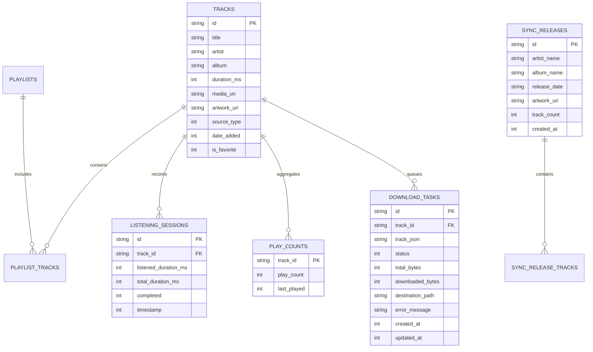

# DATABASE AND PERSISTENCE REPORT
## Echo Bloom — High-Performance SQLite Architecture, Schema Migrations & Integrity Engine

**Author:** Database Architect & Storage Engineer  
**Project:** `d:\FLutter\redesign UI`  
**Date:** 2026-11-09  

---

## 1. Relational Schema Architecture (Version 4)

The local persistence layer is powered by **SQLite 3** running with **Write-Ahead Logging (WAL)** enabled. The database contains 9 structured tables:

---

## 2. Table Specifications & Indexing Strategy

To guarantee sub-millisecond lookups even with libraries exceeding 50,000 tracks, explicit indexes are declared on all queried foreign keys and search columns:

1. **`tracks`:**
   - Indexes:
     - `idx_tracks_artist ON tracks(artist COLLATE NOCASE)`
     - `idx_tracks_album ON tracks(album COLLATE NOCASE)`
     - `idx_tracks_favorite ON tracks(is_favorite)`
     - `idx_tracks_source ON tracks(source_type)`
     - `idx_tracks_date_added ON tracks(date_added DESC)`

2. **`playlists` & `playlist_tracks`:**
   - Composite Primary Key on `playlist_tracks(playlist_id, track_id)`.
   - Index on `playlist_tracks(playlist_id, position ASC)`.

3. **`listening_sessions`:**
   - Index on `idx_listening_sessions_track ON listening_sessions(track_id)`.
   - Index on `idx_listening_sessions_timestamp ON listening_sessions(timestamp DESC)`.

4. **`play_counts`:**
   - Primary key on `track_id`. Index on `play_count DESC`.

5. **`download_tasks`:**
   - Index on `idx_download_tasks_status ON download_tasks(status)`.
   - Index on `idx_download_tasks_track_id ON download_tasks(track_id)`.

---

## 3. SQLite Configuration & PRAGMA Optimizations

Upon opening the database connection in `AppDatabase`, the following PRAGMAs are executed:
- `PRAGMA journal_mode = WAL;` (Enables concurrent reads during writes; prevents database lock contention)
- `PRAGMA foreign_keys = ON;` (Enforces referential integrity cascades)
- `PRAGMA synchronous = NORMAL;` (Maximizes write performance while preserving power-loss safety)
- `PRAGMA temp_store = MEMORY;` (Keeps temporary tables and sorting buffers in RAM)
- `PRAGMA cache_size = -8000;` (Allocates ~8MB page cache in RAM for instant index traversals)

---

## 4. Sequential Migration Engine (V1 -> V4)

Database migrations execute inside atomic SQLite transactions. If any step fails, the entire transaction is rolled back, preventing schema corruption:

- **Version 1 (Initial):** Basic `tracks`, `playlists`, `playlist_tracks` tables.
- **Version 2:** Added `source_type` and `remote_perma_url` columns to `tracks` for remote streaming.
- **Version 3:** Added `artwork_cache_key`, `year`, `genre`, and custom album artist tags.
- **Version 4 (Current Migration):**
  - Created `listening_sessions` table for fine-grained playback analytics.
  - Created `play_counts` table for 5-second qualified play counter increments.
  - Created `sync_releases` and `sync_release_tracks` for artist discography tracking.
  - Created `download_tasks` for persistent background download queue tracking.

---

## 5. Database Backup, Integrity Checks & Corrupt File Recovery

The `DatabaseBackupService` (`lib/data/local/services/database_backup_service.dart`) provides complete disaster recovery:

1. **Integrity Check:**
   - Executes `PRAGMA integrity_check;`. If the database returns anything other than `'ok'`, the file is flagged as corrupt.
2. **Corrupt File Quarantine:**
   - If a database file fails integrity checks, it is moved to `app_database.db.corrupt.{timestamp}` and a fresh, healthy V4 schema is automatically reconstructed.
3. **Atomic JSON Backup / Export:**
   - Exports the entire user library (favorites, playlists, custom tracks, listening history, play counts) into a portable JSON document.
4. **Atomic JSON Restore:**
   - Restores user data from JSON inside a single atomic transaction.

---

## 6. Verification & Automated Test Coverage

Validated by:
- `test/data/database_migration_test.dart`:
  - Verified clean upgrades from V1 to V4.
  - Verified table and index creation.
  - Verified constraints and foreign key enforcement.
- `test/data/database_backup_service_test.dart`:
  - Verified `PRAGMA integrity_check;` detection.
  - Verified atomic JSON export and import.
  - Verified corrupt database quarantine and clean recreation.

