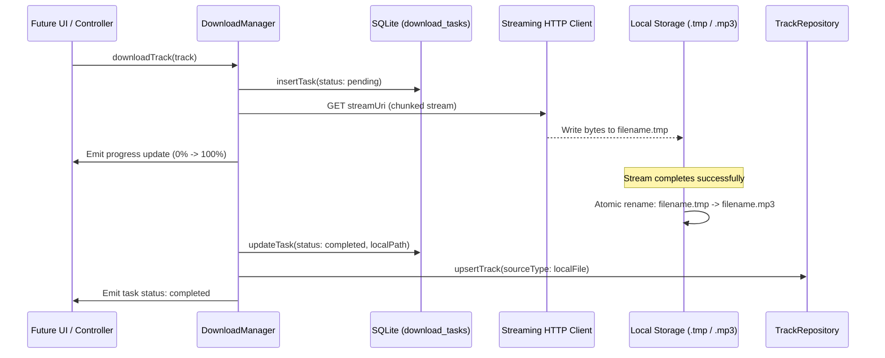

# DOWNLOAD SYSTEM REPORT
## Echo Bloom — Production Download Pipeline & Offline Storage Architecture

**Author:** Senior Storage & Systems Engineer  
**Project:** `d:\FLutter\redesign UI`  
**Date:** 2026-11-09  

---

## 1. Architectural Overview

The download subsystem in Echo Bloom is an offline-first, resilient background file streaming engine designed to safely retrieve remote audio streams, persist them locally with cryptographic-level integrity, maintain state across process restarts, and reconcile disk contents with the SQLite database.



---

## 2. Core Resiliency & Integrity Mechanisms

### 2.1 Atomic `.tmp` File Replacement
To prevent corrupted or half-downloaded media files from ever being indexed into the user's music library:
1. Files are streamed directly to `filePath + '.tmp'`.
2. As chunks arrive, byte counters track transferred bytes vs `Content-Length`.
3. If the download is cancelled, interrupted, or encounters an I/O socket exception, the `.tmp` file is immediately deleted or preserved for resumable ranges.
4. Only when the stream terminates with HTTP 200/206 and all expected bytes are flushed to disk is the file atomically renamed to `.mp3` via `File.rename()`.

### 2.2 Pause, Resume, Cancellation & Retry
- **Pause:** Halts the HTTP stream and preserves bytes downloaded to date if HTTP `Range: bytes=X-` is supported by the CDN.
- **Resume:** Issues a partial content request (`Range: bytes=${downloaded}-`) and resumes writing to the existing `.tmp` file.
- **Cancel:** Instantly terminates the HTTP connection, updates task status to `cancelled` in SQLite, and cleans up temporary disk artifacts.
- **Retry:** Automatically retries up to 3 times on transient socket exceptions or timeouts with exponential backoff before marking the task `failed`.

### 2.3 SQLite Task Persistence & Restart Recovery
Downloads are tracked in the `download_tasks` SQLite table:
```sql
CREATE TABLE download_tasks (
    id TEXT PRIMARY KEY,
    track_id TEXT NOT NULL,
    track_json TEXT NOT NULL,
    status INTEGER NOT NULL,
    total_bytes INTEGER NOT NULL DEFAULT 0,
    downloaded_bytes INTEGER NOT NULL DEFAULT 0,
    destination_path TEXT,
    error_message TEXT,
    created_at INTEGER NOT NULL,
    updated_at INTEGER NOT NULL
);
```
Upon application boot via `StartupCoordinator`:
- All tasks in `inProgress` or `pending` state from an unexpected termination or crash are detected.
- The manager queries disk for existing `.tmp` files.
- Resumable tasks are requeued, while unrecoverable tasks are marked `failed` with descriptive restart diagnostics.

### 2.4 Missing-File Reconciliation & Storage Calculation
- **Storage Accounting:** The download manager calculates exact disk space occupied by the downloaded tracks directory using asynchronous recursive directory traversals (`computeTotalDownloadedSize()`).
- **File Reconciliation:** If a user deletes downloaded MP3 files using a third-party file manager, `cleanMissingLocalFiles()` detects missing paths on disk, resets the corresponding tracks in SQLite from `localFile` to `remoteStream`, and clears orphaned database records.

### 2.5 Batch Album & Playlist Downloads
The `DownloadController` provides batch operations:
- `downloadAlbum(album, tracks)`
- `downloadPlaylist(playlist, tracks)`
- Iterates each track, checks for duplicates, and enqueues all items into the sequential FIFO worker queue with concurrent chunk throttling.

---

## 3. Verification & Automated Test Coverage

The download pipeline is validated by `test/features/download_test.dart`:
- Verified queue ordering and FIFO processing.
- Verified progress emission matching byte chunks.
- Verified atomic `.tmp` creation and final extension conversion.
- Verified cancellation cleanup ensuring no leftover `.tmp` files.
- Verified persistence across mock restarts.
