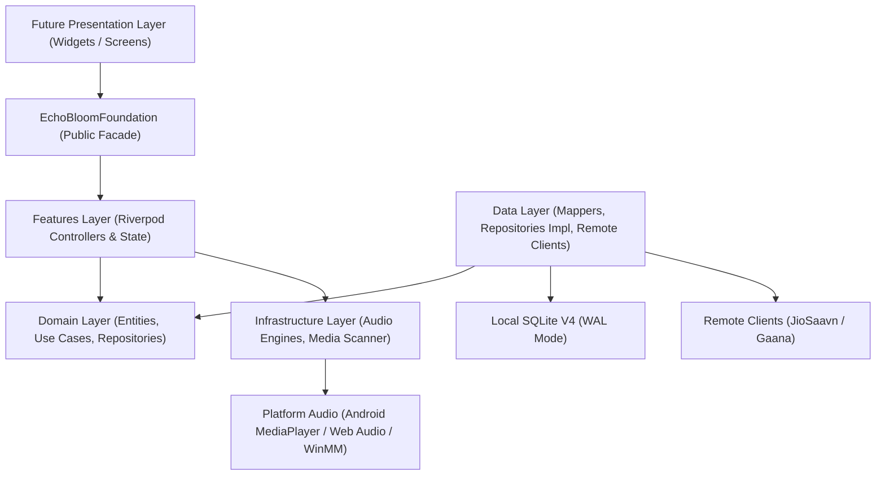
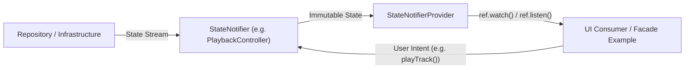

# REUSABLE ARCHITECTURE REPORT
## Echo Bloom — Reusable Music Player Foundation

**Author:** Principal Flutter Architect  
**Project:** `d:\FLutter\redesign UI`  
**Date:** 2026-11-09  

---

## 1. Architectural Blueprint & Layer Separation

Echo Bloom is designed according to **Clean Architecture** principles with strict dependency inversion. The high-level layers and their directional flows are organized as follows:



### Layer Responsibilities

1. **Core Layer (`lib/core/`):**
   - Pure Dart utilities, base error models (`Failure`), functional results (`Result<T, E>`), pagination contracts (`PageQuery`, `PaginatedList`), and structured logging (`AppLogger`).
   - Zero Flutter UI dependencies.

2. **Domain Layer (`lib/domain/`):**
   - Business entities (`Track`, `Album`, `Artist`, `Playlist`, `PlaybackState`, `DownloadTask`).
   - Repository contracts (`TrackRepository`, `PlaybackRepository`, `EqualizerRepository`, `DownloadRepository`).
   - Business rules and queue math (`PlaybackQueue`).
   - Pure Dart only.

3. **Data Layer (`lib/data/`):**
   - Local SQLite database management (`AppDatabase`), schema migrations (V1 through V4), and data sources (`LocalTrackDataSource`).
   - Remote music clients (`JioSaavnClient`, `GaanaClient`) and data source coordinator (`RemoteMusicDataSourceImpl`).
   - Data mappers (`TrackMapper`) ensuring persistence schemas remain decoupled from domain entities.
   - Database backup and recovery (`DatabaseBackupService`).

4. **Infrastructure Layer (`lib/infrastructure/`):**
   - Platform audio drivers: `AndroidAudioEngine` (Android native `MediaPlayer` + `Equalizer` audiofx), `WebAudioEngine` (Web Audio API `AudioContext` + `BiquadFilterNode` chain), and `WindowsAudioEngine` (Windows MCI/WinMM).
   - Local media scanner (`MediaScanner`) using ID3/Taglib extraction.

5. **Features Layer (`lib/features/`):**
   - StateNotifiers and Riverpod providers exposing reactive state streams for playback, downloads, search, equalizer, lyrics, sync releases, and settings.
   - Headless business logic, validation, and debounce timers.

6. **App Layer (`lib/app/`):**
   - App bootstrap and lifecycle coordination (`StartupCoordinator`).
   - Dependency container wiring (`DependencyBootstrap`).
   - Global public facade export (`echo_bloom_foundation.dart`).

---

## 2. Riverpod State Management Design

The foundation uses Flutter Riverpod for unidirectional data flow and predictable state lifecycles:



### Key Foundation Providers

| Provider Name | Type | Purpose |
| :--- | :--- | :--- |
| `playbackControllerProvider` | `StateNotifierProvider<PlaybackController, PlaybackState>` | Active track, position, duration, playback status, volume, speed, repeat, shuffle. |
| `searchControllerProvider` | `StateNotifierProvider<SearchController, SearchState>` | Query, mode, results, artists, albums, playlists, pagination (`page`, `hasMore`). |
| `downloadControllerProvider` | `StateNotifierProvider<DownloadController, DownloadState>` | Download queue, progress per track, completed tracks, storage used. |
| `equalizerControllerProvider` | `StateNotifierProvider<EqualizerController, EqualizerState>` | 5-band dB gains, enabled toggle, active preset. |
| `lyricsControllerProvider` | `StateNotifierProvider<LyricsController, LyricsState>` | Synchronized LRC lines, plain text lyrics, current active line. |
| `settingsControllerProvider` | `StateNotifierProvider<SettingsController, SettingsState>` | Theme mode, audio quality, offline/online mode, crossfade duration. |
| `syncReleasesControllerProvider`| `StateNotifierProvider<SyncReleasesController, SyncReleasesState>` | Artist discography discovery and release alerts. |

---

## 3. Public Foundation Facade Pattern

To ensure any future UI developer can interact with the engine without diving into internal wiring, the foundation exports an all-in-one public facade:

```dart
// Import everything needed for any custom UI
import 'package:echo_bloom/echo_bloom_foundation.dart';
```

### Example Usage: Initializing and Consuming the Engine

```dart
void main() async {
  WidgetsFlutterBinding.ensureInitialized();

  // 1. Initialize the entire foundation (DB, Audio, Settings, Downloads)
  final container = await StartupCoordinator.initialize();

  // 2. Access foundation services directly
  final playbackRepo = container.read(playbackRepositoryProvider);
  final searchController = container.read(searchControllerProvider.notifier);

  // 3. Search and play
  await searchController.search('Arijit Singh');
  // ...
}
```

A working headless entry point is provided in `example/foundation_example.dart` demonstrating initialization, search execution, queue manipulation, volume crossfade configuration, and clean shutdown.

