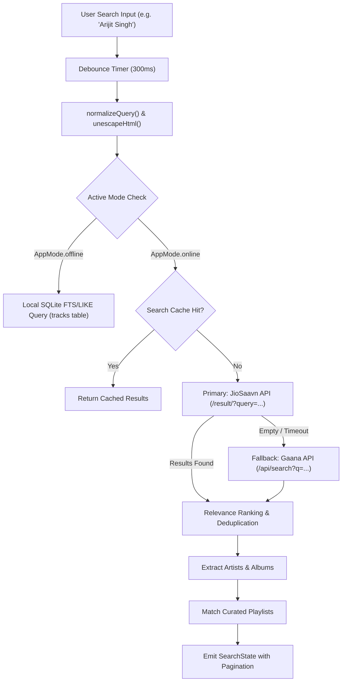

# SEARCH AND PAGINATION REPORT
## Echo Bloom — Unified Multi-Provider Music Search & Discovery

**Author:** Senior API & Backend Integration Engineer  
**Project:** `d:\FLutter\redesign UI`  
**Date:** 2026-11-09  

---

## 1. Search Architecture Overview

Echo Bloom incorporates a multi-provider search and discovery pipeline that seamlessly handles offline local database queries and remote catalog exploration:



---

## 2. API Endpoints & Contract Details

### 2.1 JioSaavn API (Primary Provider)
- **Base URL:** `https://saavnapi-nine.vercel.app`
- **Universal Search:** `/result/?query={QUERY}`
- **Lyrics Endpoint:** `/lyrics/?query={QUERY}`
- **Timeout:** 8 seconds
- **Client Class:** `JioSaavnClient` (`lib/data/remote/clients/jiosaavn_client.dart`)

### 2.2 Gaana API (Fallback Provider)
- **Base URL:** `https://shnwazdev-gaana-api.vercel.app`
- **Search Endpoint:** `/api/search?q={QUERY}&type=song`
- **Stream Endpoint:** `/api/stream?seokey={SEOKEY}`
- **Timeout:** 8 seconds
- **Client Class:** `GaanaClient` (`lib/data/remote/clients/gaana_client.dart`)

---

## 3. Query Normalization & HTML Entity Decoding

Remote Indian music APIs frequently return strings containing raw HTML entities (e.g. `&quot;`, `&#039;`, `&apos;`, `&amp;`, `&lt;`, `&gt;`, `&nbsp;`, `<br>`).

### 3.1 Unescaping Implementation
```dart
static String unescapeHtml(String text) {
  if (text.isEmpty) return text;
  return text
      .replaceAll('&quot;', '"')
      .replaceAll('&#039;', "'")
      .replaceAll('&apos;', "'")
      .replaceAll('&amp;', '&')
      .replaceAll('&lt;', '<')
      .replaceAll('&gt;', '>')
      .replaceAll('&nbsp;', ' ')
      .replaceAll('<br>', '\n')
      .replaceAll('<br/>', '\n')
      .replaceAll('<br />', '\n')
      .trim();
}
```

### 3.2 Query Sanitization & Fallback Retries
- Multiple whitespace collapses into single space (`normalizeQuery()`).
- If initial query produces zero results, special punctuation is stripped (`[^a-zA-Z0-9 ]`) and retried automatically.

---

## 4. Relevance Ranking & Deduplication Algorithms

Remote searches often return duplicate releases (e.g. standard version, radio edit, compilation, soundtrack reissue). Echo Bloom applies custom relevance ranking:

1. **Title Exact Match Bonus:** Tracks whose title starts with or equals the query receive higher priority (+100 score).
2. **Artist Exact Match Bonus:** Tracks where the primary artist matches the query receive +50 score.
3. **High Bitrate / Quality Preference:** 320kbps streams prioritized over 160kbps/96kbps.
4. **Deduplication:** A composite key `(title.toLowerCase() + '::' + artist.toLowerCase())` is maintained. Secondary duplicates with identical titles and artists are pruned, preserving the highest-quality release.

---

## 5. Offline vs Online Isolation

Strict mode boundaries are enforced by `SearchController`:
- **When `AppMode.offline`:** The search engine **strictly queries SQLite**. Network requests to JioSaavn, Gaana, or CDNs are blocked at the controller level.
- **When `AppMode.online`:** The search engine queries remote catalog providers, parses tracks, synthesizes artist/album profiles, and correlates with discovery playlists.
- Mode switching triggers an immediate re-query without manual user retyping.

---

## 6. Pagination & Incremental Exploration

To ensure smooth 60fps scrolling in future UI lists, `SearchState` and `SearchController` provide full pagination support:

### State Properties
```dart
final int page;
final bool hasMore;
final bool isLoadingMore;
```

### `loadNextPage()` Operation
1. Verifies that `!isLoadingMore`, `hasMore == true`, and `query.isNotEmpty`.
2. Emits `isLoadingMore = true`.
3. In **Offline Mode**:
   - Queries `searchTracks(query)`.
   - Takes slice `offset = localResults.length`, `limit = 20`.
   - Appends new tracks to `localResults`.
   - Sets `hasMore = (totalTracks > localResults.length)`.
4. In **Online Mode**:
   - Queries next remote page.
   - Filters out already loaded track IDs to prevent duplicate keys in UI lists.
   - Appends new items to `remoteResults`.
   - Updates `page += 1`.
5. Emits `isLoadingMore = false`.

---

## 7. Automated Test Coverage

Verified by:
- `test/features/search/search_controller_test.dart`:
  - Verified offline queries zero remote APIs.
  - Verified online queries invoke remote catalog.
  - Verified empty query resets state without network.
  - Verified mode switching updates results dynamically.
  - Verified `loadNextPage()` appends results and updates page count.
- `test/features/search/multi_provider_search_test.dart`:
  - Verified JioSaavn-to-Gaana failover.
  - Verified HTML entity decoding.
  - Verified relevance scoring and deduplication.

